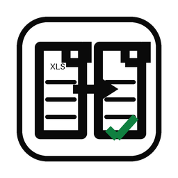

# XLS to XLSX Converter



An offline Python library, command-line tool, and Windows desktop application for converting legacy binary `.xls` files and HTML-disguised `.xls` exports into modern `.xlsx` workbooks.

## Production showcase

This converter was implemented for spreadsheet workflows used by DCApps. It is not the complete DCApps source code.

- [Open DCApps](https://dcapps.lhs.codes/)

## Features

- Batch conversion through a Tkinter desktop interface
- Scriptable `xls2xlsx` command-line interface
- Binary BIFF `.xls` and HTML-disguised `.xls` detection
- Formatting, merged-cell, row-height, column-width, and core data-type preservation
- Generic HTML table conversion with optional recognition of known public-export layouts
- Fully offline processing: external stylesheets are deliberately ignored
- Synthetic tests only; no source or converted production workbook is included

## Example output

```text
> xls2xlsx synthetic-report.xls
Converted: synthetic-report.xls -> synthetic-report_converted.xlsx
```

The output workbook preserves the source sheet structure while safely keeping identifier-like values as text. Strings beginning with `=` are written as inert text rather than executable spreadsheet formulas.

## Install

Python 3.11 or newer is required.

```bash
python -m venv .venv
python -m pip install --upgrade pip
python -m pip install -e .
```

Launch the desktop interface:

```bash
python -m xls_to_xlsx_converter
```

Convert from the command line:

```bash
xls2xlsx report.xls
xls2xlsx one.xls two.xls --output-dir converted
xls2xlsx report.xls --overwrite
```

Existing output files are never replaced unless `--overwrite` is explicitly supplied.

## Python API

```python
from xls_to_xlsx_converter import convert_file

output = convert_file("report.xls")
print(output)
```

## Windows executable

Use a standard Windows Python installation that includes Tkinter. The build
script stops during preflight if Tk or another GUI build dependency is missing.

```powershell
python -m pip install -e ".[build]"
.\build.ps1
```

The executable is written to `dist\XLS to XLSX Converter.exe`. Build products are intentionally excluded from Git.

## Security boundary

- Input is limited to `.xls` files no larger than 50 MB.
- HTML row, column, span, and expanded-cell limits fail closed.
- Only embedded CSS is parsed; conversion performs no network request.
- Only HTTP and HTTPS hyperlinks without embedded credentials are retained.
- Output is written atomically and existing files are protected by default.
- Conversion is not a malware scanner. Process files from trusted sources and scan unknown files before opening them.

See [`SECURITY.md`](SECURITY.md) for threat-model details and reporting instructions.

## Format limitations

Legacy charts, macros, embedded objects, VBA modules, comments, and formula definitions are not preserved. For binary workbooks, cached formula results may be copied as values. Conversion focuses on worksheet data and conventional cell formatting.

## Development

```bash
python -m pip install -e ".[dev]"
python -m pytest --cov=xls_to_xlsx_converter --cov-report=term-missing
python -m pip_audit
```

All test workbooks are generated at runtime with synthetic values.

## License

Original code, documentation, and project assets are available under the [MIT License](LICENSE).
